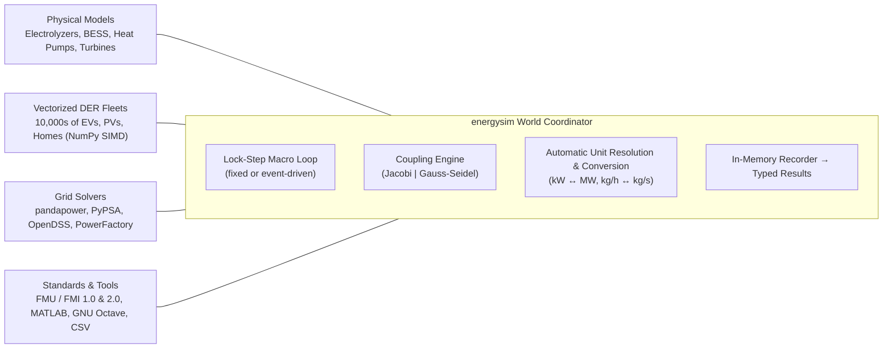

# energysim

<p align="center">
  
  
</p>

<p align="center">
  <a href="https://pypi.org/project/energysim/"></a>
  <a href="https://www.python.org/downloads/"></a>
  <a href="https://energysim.readthedocs.io"></a>
  <a href="https://github.com/dgusain1/energysim/blob/main/LICENSE"></a>
</p>

<p align="center">
  <b>Open-source Python framework for multi-energy system (MES) modeling, sector coupling, and heterogeneous co-simulation.</b>
</p>

<p align="center">
  <a href="https://energysim.readthedocs.io">Documentation</a> &bull;
  <a href="#quick-start">Quick Start</a> &bull;
  <a href="#interactive-tutorials--case-studies">Tutorials & Notebooks</a> &bull;
  <a href="#supported-simulators--grid-solvers">Supported Simulators</a> &bull;
  <a href="https://github.com/dgusain1/energysim/issues">Community & Issues</a>
</p>

---

## What is energysim?

Modern energy transitions rely heavily on **sector coupling** &mdash; the complex physical and economic interactions between electricity grids, district heating networks, natural gas pipelines, and green hydrogen supply chains. 

Traditional simulation approaches force engineers and researchers into painful trade-offs:
- **Single-domain tools** (like pure power flow solvers or building envelope simulators) ignore cross-carrier feedback dynamics.
- **Monolithic models** attempt to solve all equations simultaneously, becoming computationally intractable and difficult to maintain.

**`energysim` solves this through modular co-simulation.** 

Instead of forcing all equipment into one rigid solver, `energysim` orchestrates specialized simulators, native physical ODE models, and high-speed vectorized asset fleets through a unified co-simulation coordinator (`World`):



### How it Works:
1. **Lock-Step Synchronization**: Simulators advance their internal physics independently during micro-steps and exchange boundary variables at coordinated macro-steps (`t_macro`).
2. **Automatic Physical Unit Conversion**: Variables connected across models are validated and automatically scaled (e.g. converting `kW` to `MW` or `degC` to `K`) based on a first-class unit registry. Mismatched dimensions raise immediate validation errors.
3. **Loop & Delay Resolution**: Feedback loops between coupled models are detected topologically and resolved with a deterministic one-macro-step delay.
4. **Adaptive Event Stepping**: The simulation time grid automatically refines (`t_macro_min`) to land precisely on scheduled grid outages, control triggers, or device events.

---

## Why energysim?

| Capability | What it gives you |
|---|---|
| 🔋 **25+ Multi-Physics Components** | Out-of-the-box physical ODE models for **PEM / Alkaline / SOEC electrolyzers**, hydrogen storage tanks, fuel cells, Li-ion batteries with degradation, industrial heat pumps, CCGT/OCGT, and solar/wind. |
| ⚡ **C-Speed Vectorized Fleets** | Simulate **10,000+ residential batteries, EVs, rooftop PVs, or heat pumps simultaneously** in sub-millisecond NumPy array operations without slow Python object dispatch loops. |
| 🔌 **Universal Co-Simulation** | Connect power grids (**pandapower, PyPSA, OpenDSS, PowerFactory**), multi-physics standards (**FMI 1.0 / 2.0 FMUs** via FMPy), and math models (**MATLAB / GNU Octave**) into a single unified world. |
| 📐 **Parameter Ingestion (`.from_model`)** | Define a calibrated physical asset or archetype once and replicate it across a 1,000-unit fleet with realistic stochastic parameter variation (`spread`). |
| 🛡️ **Zero-Surprise Pre-Run Validation** | `world.validate()` checks connection topologies, unit compatibility, and step-size alignment before execution. Safe mode sandboxes untrusted YAML scenarios. |
| 📊 **Interactive Analytics** | Export results directly to Pandas / Polars DataFrames, Apache Parquet, or self-contained offline **HTML interactive dashboards** with zero extra setup. |

---

## Installation

Install the lightweight core engine:

```bash
pip install energysim             # or: uv add energysim
```

The core package only requires `numpy`, `pandas`, `tqdm`, `networkx`, and `pyyaml`. Specialized grid solvers, FMU support, and optimization modules are available as optional extras:

<!-- extras:start -->
<!-- Generated from pyproject.toml by scripts/generate_readme_features.py. Do not edit by hand. -->

With pip:

```bash
pip install energysim            # core: numpy, pandas, tqdm, networkx, pyyaml
pip install energysim[fmu]       # adds fmpy>=0.3.27,<0.4
pip install energysim[powerflow] # adds pandapower>=3.0,<4
pip install energysim[pypsa]     # adds pypsa>=0.30,<2
pip install energysim[opendss]   # adds opendssdirect.py>=0.9,<1
pip install energysim[plotting]  # adds matplotlib
pip install energysim[networks]  # adds scipy
pip install energysim[control]   # adds scipy>=1.9
pip install energysim[results]   # adds pyarrow
pip install energysim[hdf5]      # adds tables
pip install energysim[all]       # everything above
```

With uv:

```bash
uv add energysim
uv add energysim[fmu]       # adds fmpy>=0.3.27,<0.4
uv add energysim[powerflow] # adds pandapower>=3.0,<4
uv add energysim[pypsa]     # adds pypsa>=0.30,<2
uv add energysim[opendss]   # adds opendssdirect.py>=0.9,<1
uv add energysim[plotting]  # adds matplotlib
uv add energysim[networks]  # adds scipy
uv add energysim[control]   # adds scipy>=1.9
uv add energysim[results]   # adds pyarrow
uv add energysim[hdf5]      # adds tables
uv add energysim[all]       # everything above
```
<!-- extras:end -->

*External tools requiring local installations: DIgSILENT PowerFactory (2020+ API), MATLAB (MATLAB Engine for Python), or GNU Octave (`pip install oct2py` + Octave on `PATH`).*

---

## Quick Start

### 60-Second Sector Coupling: Solar PV + Battery + PEM Electrolyzer + Hydrogen Tank

This self-contained Python script simulates a 24-hour green hydrogen production facility. Note how irradiance, electric power, and hydrogen mass flow are connected across domains with **automatic unit scaling**:

```python
import energysim as es
from energysim.models import PhysicsPV, BatteryBESS, PEMElectrolyzer, H2StorageTank

# 1. Create the world coordinator (24h simulation, 15-minute macro exchange)
world = es.World(start_time=0, stop_time=86400, t_macro=900)

# 2. Add physical component models
world.add_model("pv", PhysicsPV(p_dc_stc_mw=12.0, inverter_p_ac_max_mw=10.0), step_size=900)
world.add_model("bess", BatteryBESS(capacity_mwh=4.0, p_max_mw=2.0, soc_init=0.5), step_size=60)
world.add_model("pem", PEMElectrolyzer(p_nominal_mw=8.0), step_size=60)
world.add_model("tank", H2StorageTank(volume_m3=100.0, p_init_bar=50.0), step_size=60)

# 3. Add dynamic solar irradiance and dispatch profiles
daylight = "max(0, sin(pi * (t - 6*3600) / (12*3600)))"
world.add_signal("sun", f"900 * {daylight}", step_size=900)
world.add_signal("p_pem", f"6 * {daylight}", step_size=900, units={"y": "MW"})

# 4. Connect streams across domains
world.add_connections({
    "sun.y": "pv.G_poa",
    "p_pem.y": "pem.P_cmd",
    "pem.m_dot_H2_kg_hr": "tank.m_dot_in_kg_hr",
})

# 5. Simulate and analyze results
res = world.simulate()

print(f"Total H2 produced: {res['tank.mass_stored_kg'].iloc[-1] - res['tank.mass_stored_kg'].iloc[0]:.1f} kg")
print(f"Final tank pressure: {res['tank.pressure_bar'].iloc[-1]:.1f} bar")
```

---

## Vectorized DER Fleets at Scale

Simulating thousands of distributed assets (EVs, rooftop PVs, residential heat pumps) with individual Python objects creates severe interpreter bottlenecks. `energysim` provides **Vectorized Container Simulators** that step $N$ entities simultaneously in C-speed contiguous NumPy arrays:

```python
import energysim as es
from energysim import models

# Define a single calibrated asset or archetype
home_bess = models.BatteryBESS(capacity_mwh=0.0135, p_max_mw=0.005) # 13.5 kWh Powerwall

world = es.World(start_time=0, stop_time=86400, t_macro=900)

# Ingest directly into a 1,000-unit fleet with +/-10% stochastic spread across homes!
world.add_fleet("ev_fleet", model=home_bess, size=1000, spread=0.10, seed=42)
world.add_fleet("rooftop_pv", kind="pv", size=1000, peak_kw=5.0)

res = world.simulate()
print("Community peak battery power:", res["ev_fleet.total_actual_p_kw"].max(), "kW")
```

---

## Declarative YAML & CLI Runner

Simulations can be defined entirely in declarative YAML files for automated headless execution, batch workflows, and CI/CD testing:

```bash
# Validate scenario structure, units, and connections
energysim validate scenario.yaml

# Run simulation and launch the interactive HTML dashboard
energysim run scenario.yaml --dashboard
```

---

## Interactive Tutorials & Case Studies

The repository includes a curated collection of **21 executable Jupyter notebooks** in [`examples/notebooks/`](examples/notebooks/):

| Category | Notebook | Description |
|---|---|---|
| **Getting Started** | `00_model_catalog_starter_guide.ipynb` | Starter guide for all physical components (BESS, PV, Wind, PEM, Heat Pumps). |
| | `01_quickstart_multi_energy_cosim.ipynb` | Complete multi-carrier microgrid with solar, battery, and diesel dispatch. |
| **Grid Co-Simulation** | `02_grid_cosim_pandapower_pypsa_opendss.ipynb` | AC power flow co-simulation across pandapower, PyPSA, and OpenDSS. |
| | `12_dso_feeder_with_fleets.ipynb` | 1,000 rooftop PVs and EV fleets integrated into a medium-voltage distribution feeder. |
| **Vectorized DER Fleets** | `06_vectorized_fleet_aggregation.ipynb` | SIMD vectorized container scaling to 10,000 residential batteries. |
| | `10_fleet_heatpump_buildings.ipynb` | 1,000 heat pumps coupled with 1R1C thermal building envelopes. |
| | `20_simplified_vectorized_and_ensemble_modeling.ipynb` | Functional fleet modeling (`SimpleVectorizedModel`) and parameter sweeps. |
| **Hydrogen & Gas** | `07_green_hydrogen_valley.ipynb` | Green hydrogen valley: electrolyzers, compressors, storage tanks, and fuel cells. |
| | `14_power_gas_cold_snap.ipynb` | Multi-carrier winter cold-snap adequacy study across power, gas, and heat. |
| **External Standards & Tools** | `16_fmu_with_builtin_physics.ipynb` | FMI 2.0 Co-Simulation FMUs coupled with native `energysim` physical models. |
| | `17_gnu_octave_matlab_cosim.ipynb` | GNU Octave & MATLAB co-simulation guide with custom `.m` model contracts. |
| | `18_powerfactory_cosim_setup.ipynb` | DIgSILENT PowerFactory load flow co-simulation setup with transparent mock fallback. |
| | `19_online_fmus_and_fmi_standards.ipynb` | Downloading and executing official Modelica Association FMI Cross-Check FMUs. |

*See the full [Curriculum Roadmap & Learning Paths](https://energysim.readthedocs.io/en/latest/notebooks-roadmap/) on ReadTheDocs.*

---

## Results & Standalone HTML Dashboard

Results are returned as a typed `Results` container. You can query variables by dot notation, convert to wide DataFrames, calculate energy KPIs, or export a self-contained offline HTML dashboard:

```python
res = world.simulate()

df = res.to_frame(resample='15min')      # Wide pandas DataFrame
kpis = res.kpis()                        # Energy integrals (kWh), peak demands, averages
res.save('run_output')                   # Export as Apache Parquet + meta.json

# Generate interactive standalone HTML dashboard with Plotly charts
res.dashboard('dashboard.html', open=True)
```

---

## Detailed Engine Capabilities & Status Matrix

<details>
<summary><b>Click to expand full capability matrix</b> (tracked across continuous integration test suite)</summary>

<!-- features:start -->
<!-- Generated from features.yaml by scripts/generate_readme_features.py. Do not edit by hand. -->

**Simulator adapters**

| Capability | Status | Description |
|---|---|---|
| [CSV profile adapter](https://energysim.readthedocs.io/en/latest/add-simulator/) | stable | Replay time series from a CSV file as a simulator (zero-order hold, strict column checks). |
| [Signal generators](https://energysim.readthedocs.io/en/latest/add-simulator/) | stable | Python callables and safe expression strings as signal sources. |
| [Python script adapter](https://energysim.readthedocs.io/en/latest/add-simulator/) | stable | Wrap a user Python module as a simulator (disabled in safe mode). |
| [External simulator interface](https://energysim.readthedocs.io/en/latest/external-simulators/) | stable | Plug any object or factory implementing the adapter contract into a world. |
| [FMU co-simulation (FMI 1.0 / 2.0)](https://energysim.readthedocs.io/en/latest/add-simulator/) | stable | Run Co-Simulation FMUs through FMPy with start values, feed-through and re-runs. |
| [FMU model exchange](https://energysim.readthedocs.io/en/latest/add-simulator/) | stable | Integrate Model-Exchange FMUs with CVode, including time/state events. |
| [pandapower networks](https://energysim.readthedocs.io/en/latest/add-simulator/) | stable | AC/DC power flow and OPF through pandapower, validated against direct runpp. |
| [PyPSA networks](https://energysim.readthedocs.io/en/latest/add-simulator/) | stable | Single-snapshot online power flow / dispatch of PyPSA networks. |
| [OpenDSS distribution feeders](https://energysim.readthedocs.io/en/latest/add-simulator/) | stable | Unbalanced AC distribution feeders via OpenDSSDirect.py (DC mode rejected). |
| [DIgSILENT PowerFactory](https://energysim.readthedocs.io/en/latest/add-simulator/) | beta | AC / DC load flow through the PowerFactory Python API; CI uses a mock, a licensed run is manual. |
| [MATLAB / GNU Octave functions](https://energysim.readthedocs.io/en/latest/add-simulator/) | beta | Call .m functions through the MATLAB Engine or Octave (oct2py), auto-detected. |
| [Uniform adapter contract](https://energysim.readthedocs.io/en/latest/architecture/) | stable | Every adapter kind passes one contract suite and is interchangeable inside a world. |

**Coupling and numerics**

| Capability | Status | Description |
|---|---|---|
| [Jacobi coupling](https://energysim.readthedocs.io/en/latest/architecture/) | stable | Default parallel coupling; every stage sees the previous macro step's outputs. |
| [Gauss-Seidel coupling](https://energysim.readthedocs.io/en/latest/architecture/) | stable | Sequential coupling in topological order so downstream models see fresh upstream outputs. |
| [Algebraic-loop detection](https://energysim.readthedocs.io/en/latest/architecture/) | stable | Feedback loops are detected, warned about and resolved with a one-step delay. |
| [Input extrapolation](https://energysim.readthedocs.io/en/latest/architecture/) | stable | Zero-order hold or linear extrapolation of coupled inputs between macro steps. |
| [Events and variable macro step](https://energysim.readthedocs.io/en/latest/events/) | stable | Scheduled events, threshold triggers and adapter step hints; the macro step shrinks to land on events (t_macro_min). |

**Units**

| Capability | Status | Description |
|---|---|---|
| [Unit-aware connections](https://energysim.readthedocs.io/en/latest/units/) | stable | Declared or inferred units are converted automatically across connections; incompatible units raise. |
| [Unit policy](https://energysim.readthedocs.io/en/latest/units/) | stable | A variable with no determinable unit is never scaled (a warning by default, an error with unit_policy='strict'); a manual scale disables conversion. |

**Scenarios, validation and safety**

| Capability | Status | Description |
|---|---|---|
| [Pre-run validation](https://energysim.readthedocs.io/en/latest/yaml-cli/) | stable | world.validate() reports unknown names, unit clashes and step-size problems before running. |
| [Command-line interface](https://energysim.readthedocs.io/en/latest/yaml-cli/) | stable | `energysim validate` and `energysim run` with stable exit codes and --out / --safe flags. |
| [Safe mode](https://energysim.readthedocs.io/en/latest/safe-mode/) | stable | Refuses scripts, external code, FMUs, pickles, dotted imports and paths outside the scenario directory when running untrusted scenario files. |
| [Declarative YAML scenarios](https://energysim.readthedocs.io/en/latest/yaml-cli/) | stable | Describe a world in YAML, load it with world.from_yaml and round-trip it with to_yaml. |
| [Glass-box access](https://energysim.readthedocs.io/en/latest/architecture/) | stable | get_adapter / get_model expose the live objects inside a world. |

**Results and visualisation**

| Capability | Status | Description |
|---|---|---|
| [Results object](https://energysim.readthedocs.io/en/latest/results/) | stable | Typed per-simulator tables with units and run metadata; nothing is written to disk by default. |
| [Save and load formats](https://energysim.readthedocs.io/en/latest/results/) | stable | Parquet (CSV fallback), CSV and HDF5 export with a meta.json and reload via Results.load. |
| [KPIs and summaries](https://energysim.readthedocs.io/en/latest/results/) | stable | Energy integrals, time-weighted means and user-registered KPIs. |
| [Interactive HTML dashboard](https://energysim.readthedocs.io/en/latest/results/) | stable | Self-contained offline HTML dashboard generated from a Results object. |
| [Ensembles and parameter sweeps](https://energysim.readthedocs.io/en/latest/ensemble/) | stable | Run many scenario variants (grids, samplers, noise) and collect them in one Results object. |

**Built-in physical models**

| Capability | Status | Description |
|---|---|---|
| [Storage models](https://energysim.readthedocs.io/en/latest/components/bess/) | stable | BatteryBESS (Rint ECM + thermal + aging), FlowBattery (VRFB) and Flywheel. |
| [Renewable models](https://energysim.readthedocs.io/en/latest/components/pv/) | stable | PhysicsPV (NOCT cell temperature, inverter clipping), WindTurbine and SolarThermalCollector. |
| [Hydrogen and PtX models](https://energysim.readthedocs.io/en/latest/components/pem_electrolyzer/) | stable | PEM / alkaline / SOEC electrolyzers, H2 compressor and tank, PEM / SOFC fuel cells, methanation. |
| [Thermal generation models](https://energysim.readthedocs.io/en/latest/components/ocgt/) | stable | OCGT with start-up timers, CCGT (fixed GT/ST split, part-load heat rate), reciprocating genset and CHP steam turbine. |
| [Heating, cooling and thermal storage models](https://energysim.readthedocs.io/en/latest/components/heat_pump/) | stable | Industrial heat pump (Carnot-lift COP), electric boiler, electric / absorption chillers, thermal storage tank. |
| [Carbon capture](https://energysim.readthedocs.io/en/latest/components/carbon_capture/) | stable | Amine-based post-combustion CarbonCapture_Amine. |
| [Industrial and data-centre loads](https://energysim.readthedocs.io/en/latest/components/datacenter/) | stable | DataCenterLoad and IndustrialProcessSteam demand models. |
| [Model framework](https://energysim.readthedocs.io/en/latest/custom-models/) | stable | ModelComponent base with describe(), strict variable access, units on every variable and deterministic re-runs. |
| [Equipment archetypes](https://energysim.readthedocs.io/en/latest/components/catalog/) | stable | Generic documented archetypes (BESS_2h_2MW, PEM_5MW, ...) with provenance; brand-named aliases are deprecated. |

**Vectorized fleets**

| Capability | Status | Description |
|---|---|---|
| [Vectorized fleet containers](https://energysim.readthedocs.io/en/latest/containers/overview/) | stable | Battery, PV and building fleets of N units advanced in one NumPy step, equal to a loop of scalar models. |
| [Custom vectorized fleets](https://energysim.readthedocs.io/en/latest/containers/custom_fleet/) | stable | Subclass VectorizedContainerAdapter or pass an update function to VectorizedFunctionAdapter. |

**Energy networks**

| Capability | Status | Description |
|---|---|---|
| [Energy networks](https://energysim.readthedocs.io/en/latest/networks/) | stable | Producer / consumer / storage graphs with an LP balance, pipe limits, merit order and losses. |
| [Heat and gas networks](https://energysim.readthedocs.io/en/latest/networks/) | stable | HeatNetwork (transport delay, temperatures) and GasNetwork (MW_LHV / Nm3/h units, linepack). |

**Control and optimisation**

| Capability | Status | Description |
|---|---|---|
| [Economic MPC](https://energysim.readthedocs.io/en/latest/control/) | beta | Receding-horizon LP/MILP controller over library blocks (storage, electrolyzer, heat pump, ...). |
| [OPF and PyPSA controllers](https://energysim.readthedocs.io/en/latest/control/) | beta | pandapower OPF and PyPSA rolling-horizon controllers wrapped as energysim controllers. |
| [Forecast providers](https://energysim.readthedocs.io/en/latest/control/) | beta | Perfect, persistence, callable and seeded noisy forecasts for controllers. |

**Quality assurance**

| Capability | Status | Description |
|---|---|---|
| [Physical validation suite](https://energysim.readthedocs.io/en/latest/validation/) | stable | Analytic, textbook and cross-tool benchmarks with sourced tolerances, published in the docs. |
| [Clean-install packaging](https://energysim.readthedocs.io/en/latest/faq/) | stable | The wheel ships py.typed and installs and imports cleanly in a fresh venv. |

**Planned and removed**

| Capability | Status | Description |
|---|---|---|
| [Iterative (fixed-point) coupling](https://energysim.readthedocs.io/en/latest/architecture/) | removed | Removed in 3.0 because it relied on rollback that adapters never supported; world() now raises. |
| [State rollback API](https://energysim.readthedocs.io/en/latest/architecture/) | removed | save_state / restore_state were removed; no adapter implements rollback. |

Status legend: `stable` and `beta` features are covered by the test suite listed in `features.yaml`; `planned` features are not implemented yet; `removed` ones raise a clear error.
<!-- features:end -->

</details>

---

## Parameter Reference

<details>
<summary><b>Click to expand parameter reference</b> (<code>world()</code> and <code>add_simulator()</code> signatures)</summary>

<!-- params:start -->
<!-- Generated from the signatures by scripts/generate_readme_features.py. Do not edit by hand. -->

### `world()` parameters

| Parameter | Default | Description |
|---|---|---|
| `start_time` | `0` | Simulation start time in seconds. |
| `stop_time` | `1000` | Simulation end time in seconds; `stop_time - start_time` must be a multiple of `t_macro` (unless `t_macro_min < t_macro`). |
| `logging` | `False` | Print INFO progress messages of the `energysim` logger. |
| `t_macro` | `60` | Macro time-step (variable exchange interval); `0` means the LCM of all simulator step sizes. |
| `coupling` | `'jacobi'` | Coupling strategy: `'jacobi'` or `'gauss-seidel'`. |
| `extrapolation` | `'zero-order'` | Input extrapolation between macro steps: `'zero-order'` or `'linear'`. |
| `power_unit` | `None` | World default power unit used to resolve unit-less power variables. |
| `start_datetime` | `None` | Optional wall-clock start; results are then indexed by datetime. |
| `seed` | `None` | Optional random seed, recorded in the results metadata. |
| `out_dir` | `None` | If set, every run is written to `<out_dir>/<timestamp>_<hash>/`. |
| `unit_system` | `None` | `None`, `'default'`, `'si'`, an overrides dict or a `UnitSystem`. |
| `unit_policy` | `'lenient'` | `'lenient'` (default; unspecified units pass through with a warning) or `'strict'` (unspecified units on connections raise). |
| `t_macro_min` | `None` | Smallest macro step when adapters report step hints or events occur (default: `t_macro`, i.e. fixed step). |

### `add_simulator()` parameters

| Parameter | Default | Description |
|---|---|---|
| `sim_type` | `''` | `'fmu'`, `'powerflow'`, `'pypsa'`, `'opendss'`, `'csv'`, `'signal'`, `'external'`, `'powerfactory'`, `'matlab'`, `'script'`, `'model'` or a fleet kind (`'battery_fleet'`, ...). |
| `sim_name` | `''` | Unique identifier for this simulator. |
| `sim_loc` | `None` | Path / object of the model (alias of `model`; many other aliases such as `net`, `path` exist). |
| `inputs` | `None` | List of input variable names. |
| `outputs` | `None` | List of output variable names to record. |
| `step_size` | `1` | Micro time-step. |
| `mode` | `'ac'` | Power-flow mode: `'ac'` or `'dc'`. |
| `power_unit` | `None` | Power unit of this simulator's variables (default: the world's `power_unit`). |
| `units` | `None` | Optional `{variable: unit}` mapping that overrides inferred units. |
| `model` | `None` | Model object, file path or factory. |
| `allow_import` | `False` | Allow dotted-import model references (`'pandapower.networks.case14'`); refused in safe mode. |

Type-specific keyword arguments:

- **FMU**: `validate` (bool), `variable` (bool), `solver_name`
- **Power flow** (`pandapower`, `pypsa`, `opendss`): `mode` - `'ac'` or `'dc'`
- **CSV**: `delimiter` (str)
- **PowerFactory**: `mode` - `'ac'` or `'dc'` (load flow); `pf_path` (str)
- **MATLAB / Octave**: `engine` - `'auto'`, `'matlab'` or `'octave'`
<!-- params:end -->

</details>

---

## Community & Citation

`energysim` is free software licensed under the **GNU General Public License v3.0** by Digvijay Gusain ([@dgusain1](https://github.com/dgusain1)).

If you use `energysim` in your academic research, please cite our IEEE PowerTech paper:

```bibtex
@inproceedings{gusain2019energysim,
  author    = {Gusain, Digvijay and Cvetkovi{\'c}, Milo{\v{s}} and Palensky, Peter},
  title     = {Energy flexibility analysis using {FMUWorld}},
  booktitle = {2019 IEEE Milan PowerTech},
  year      = {2019},
  pages     = {1--6},
  doi       = {10.1109/PTC.2019.8810433}
}
```
