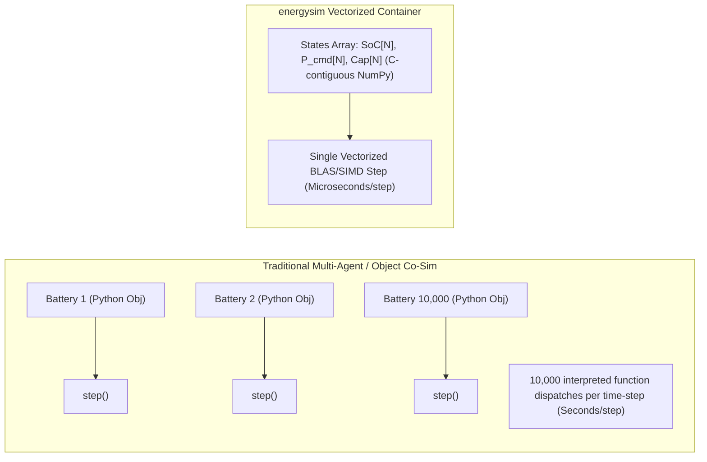

# Vectorized Fleet Containers

Large-scale co-simulations involving tens of thousands of Distributed Energy Resources (DERs) — such as rooftop solar PV, residential batteries, electric vehicles, and smart thermostats — typically suffer severe performance bottlenecks when implemented as individual interpreted Python objects. 

`energysim` solves this via **Vectorized Container Simulators** (`VectorizedContainerAdapter`).

---

## Core Architecture

Instead of instantiating 10,000 separate model objects and dispatching 10,000 Python method calls every micro time-step, a **Vectorized Container** stores the states and parameters of all $N$ assets in **contiguous 1-D C-memory NumPy arrays**:

### Key Architectural Capabilities

1. **Scalar Broadcast & Vector Control**:
   - Setting a scalar input (e.g. `ambient_temperature = 22.0`) automatically broadcasts to all $N$ entities.
   - Passing an $N$-element array updates each entity individually.
   - Setting an indexed variable (e.g. `p_cmd[42] = 5.0`) modifies only the specified unit.
2. **Instant Aggregation Outputs**:
   - Any state vector automatically exposes aggregated metrics: `total_<var>`, `mean_<var>`, `min_<var>`, and `max_<var>`.
3. **Sub-millisecond Step Speeds**:
   - Stepping 10,000 batteries or PV arrays takes fewer than **300 microseconds**, enabling annual (8,760 hours) co-simulations to complete in seconds.

---

## Container Catalog

* [**Storage Fleet**](storage_fleet.md): Heterogeneous residential battery storage and EV charging aggregation.
* [**Solar PV Fleet**](pv_fleet.md): Distributed rooftop solar arrays with spatial irradiance and temperature derate.
* [**Building Thermal Fleet**](building_fleet.md): 1R1C lumped thermal envelope fleets for demand response.
* [**Build Your Own Vectorized Fleet**](custom_fleet.md): Step-by-step tutorial on subclassing `VectorizedContainerAdapter` or using `VectorizedFunctionAdapter`.
