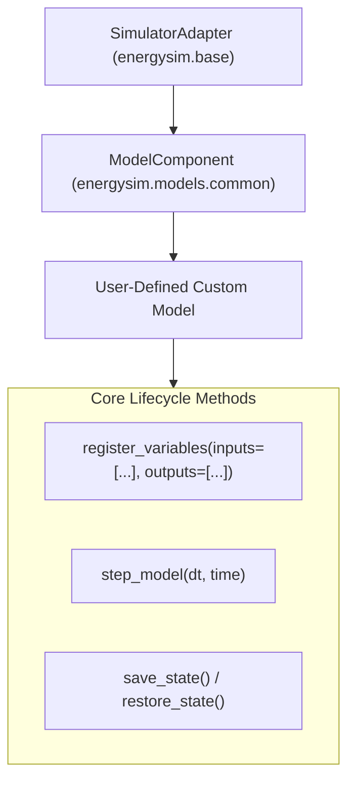

# Authoring & Parametrizing Custom Physical Models

`energysim` allows users to author their own physical component models from scratch or parametrize existing models with custom manufacturer curves and operating limits.

---

## Architecture of a Physical Model

Every physical component in `energysim` inherits from `ModelComponent`, which itself subclasses `SimulatorAdapter`:



### Key Responsibilities of `ModelComponent`

1. **Input/Output Registration**: Declares valid variable names for connection checks and result extraction.
2. **Explicit Numerical Integration**: Enforces fixed or variable step integration in `step_model(dt, time)` without relying on brittle algebraic solvers.
3. **State Management**: Provides rollback checkpoints (`save_state()` / `restore_state()`) to support iterative algebraic loop relaxation when coupled with power grids.

---

## 1. Creating a Custom Model from Scratch

To create a new model, subclass `ModelComponent` and implement `step_model(dt, time)`:

### Example: Supercapacitor Fast-Discharge Storage

Let's implement a supercapacitor model with series internal resistance ($R_{\text{esr}}$), self-discharge leakage, and voltage-dependent capacitance:

```python
from typing import Dict, Any, Optional
import numpy as np
from energysim.models.common.base_component import ModelComponent


class SupercapacitorStorage(ModelComponent):
    """
    User-defined Supercapacitor Module for high-power fast frequency response.
    """

    def __init__(
        self,
        name: str = "supercap",
        capacitance_farads: float = 500.0,
        voltage_rated_v: float = 48.0,
        r_esr_ohms: float = 0.005,
        leakage_current_a: float = 0.002,
        v_init_v: float = 48.0,
        step_size: float = 1.0,
        **kwargs,
    ):
        super().__init__(name=name, step_size=step_size, **kwargs)

        self.c_f = float(capacitance_farads)
        self.v_rated = float(voltage_rated_v)
        self.r_esr = float(r_esr_ohms)
        self.i_leak = float(leakage_current_a)

        # Internal state
        self.voltage = float(v_init_v)
        self.current_a = 0.0
        self.p_actual_kw = 0.0

        # Register input setpoints and observable output variables
        self.register_variables(
            inputs=["P_cmd_kW"],
            outputs=["P_actual_kW", "V_terminal", "I_current", "SoC", "energy_stored_kJ"],
        )

    def step_model(self, dt: float, time: float) -> None:
        """
        Advance supercapacitor state by dt seconds.
        P_cmd_kW: Positive = Charging, Negative = Discharging
        """
        p_cmd_w = float(self._inputs_val.get("P_cmd_kW", 0.0)) * 1000.0

        # Current calculation: P = V * I - I^2 * R
        # Linear approximation for small dt:
        if abs(self.voltage) > 1.0:
            i_cmd = p_cmd_w / self.voltage
        else:
            i_cmd = 0.0

        # Enforce voltage cutoffs
        if self.voltage >= self.v_rated and i_cmd > 0:
            i_cmd = 0.0
        elif self.voltage <= 5.0 and i_cmd < 0:
            i_cmd = 0.0

        self.current_a = i_cmd

        # dV/dt = (I - I_leak) / C
        dv_dt = (self.current_a - self.i_leak) / self.c_f
        self.voltage = max(0.0, min(self.v_rated, self.voltage + dv_dt * dt))

        # Terminal voltage including ESR drop
        v_terminal = self.voltage + self.current_a * self.r_esr
        self.p_actual_kw = (v_terminal * self.current_a) / 1000.0

        # Energy stored: 0.5 * C * V^2 (kJ)
        energy_kj = 0.5 * self.c_f * (self.voltage ** 2) / 1000.0
        soc = (self.voltage / self.v_rated) ** 2

        # Assign output dictionary
        self._outputs_val["P_actual_kW"] = self.p_actual_kw
        self._outputs_val["V_terminal"] = v_terminal
        self._outputs_val["I_current"] = self.current_a
        self._outputs_val["SoC"] = soc
        self._outputs_val["energy_stored_kJ"] = energy_kj
```

---

## 2. Incorporating Custom Empirical Curves (`Curve1D` & `Surface2D`)

Real equipment rarely follows ideal linear formulas. `energysim` provides `Curve1D` and `Surface2D` lookup tools that feature:
- Automatic piecewise interpolation
- Boundary clamping (preventing negative efficiencies or unphysical blowups)
- Serialization support

### Adding a Custom 1D Heat Rate or Polarization Curve

```python
from energysim.models.common.curve import Curve1D

# 1. Calibrated efficiency curve points from manufacturer test bench
# Load ratio (%):    [20%,  40%,  60%,  80%,  100%]
# Efficiency (%):    [28%,  36%,  42%,  44%,  43.5%]
load_points = [0.20, 0.40, 0.60, 0.80, 1.00]
eta_points  = [0.28, 0.36, 0.42, 0.44, 0.435]

custom_eff_curve = Curve1D(
    x_data=load_points,
    y_data=eta_points,
    min_val=0.10,    # Clamped floor
    max_val=0.50,    # Clamped ceiling
)

# Evaluating efficiency at 72% load
eff = custom_eff_curve(0.72)  # Evaluates to ~0.432
```

---

## 3. Adding Operating State Machines (`OperatingStateMachine`)

For thermal generation (turbines, engines, boilers), startup delays, warm-up purges, and ramp limits prevent unphysical instantaneous step responses.

Embed `OperatingStateMachine` into your model:

```python
from energysim.models.common.state_machine import OperatingStateMachine, OperatingState

class PeakerTurbine(ModelComponent):
    def __init__(self, name="peaker", p_rated_mw=25.0, **kwargs):
        super().__init__(name=name, **kwargs)
        self.p_rated_mw = p_rated_mw
        
        # Configure state machine: 10 min hot start, 30 min warm, 60 min cold
        self.sm = OperatingStateMachine(
            hot_start_time_sec=600.0,
            warm_start_time_sec=1800.0,
            cold_start_time_sec=3600.0,
            ramp_rate_up_mw_min=5.0,
            ramp_rate_down_mw_min=10.0,
        )
        self.register_variables(inputs=["P_cmd"], outputs=["P_actual", "state"])

    def step_model(self, dt: float, time: float) -> None:
        p_cmd = float(self._inputs_val.get("P_cmd", 0.0))
        self.sm.update_time(dt)
        
        # State transitions
        if p_cmd > 0 and self.sm.state == OperatingState.OFF:
            self.sm.initiate_start()
            
        p_out = self.sm.step_power(p_cmd, dt)
        self._outputs_val["P_actual"] = p_out
        self._outputs_val["state"] = self.sm.state.value
```

---

## 4. Parametrizing Existing Models Differently

Rather than rewriting models, you can parametrize existing models by passing custom parameters or calibrated curves directly into their constructors.

### Customizing a `CombinedCycle_CCGT`

```python
from energysim.models.thermal import CombinedCycle_CCGT
from energysim.models.common.curve import Curve1D

# Custom ambient derating curve: aggressive summer degradation
ambient_temps = [-10.0, 0.0, 15.0, 30.0, 45.0]
derate_mults  = [1.10, 1.05, 1.00, 0.90, 0.78]
custom_amb = Curve1D(ambient_temps, derate_mults)

# Instantiate CCGT with site-specific curves
site_ccgt = CombinedCycle_CCGT(
    name="site_ccgt",
    p_rated_mw=250.0,
    min_stable_gen_pct=30.0,          # Enhanced turndown burner
    ramp_rate_mw_min=20.0,            # Fast-ramp capability
    ambient_derate_curve=custom_amb,  # Custom ambient curve
)
```

### Customizing a `PEMElectrolyzer`

```python
from energysim.models.hydrogen import PEMElectrolyzer

# Overriding stack cell area, membrane thickness, and specific power consumption
custom_pem = PEMElectrolyzer(
    name="high_efficiency_pem",
    p_nominal_mw=15.0,
    specific_consumption_kwh_kg=48.5,  # Next-gen catalyst (48.5 vs 52.0 kWh/kg)
    min_turndown_pct=5.0,              # 5% deep turndown
    operating_pressure_bar=50.0,       # Direct 50-bar delivery
)
```

---

## 5. Packaging into Your Own Archetype Catalog

You can organize your organization's verified equipment models into a custom catalog file:

```python
# my_company_models.py
from energysim.models.storage import BatteryBESS

def HighPower_GridBooster_2MW(name="booster", **kwargs):
    default_params = {
        "capacity_mwh": 2.0,           # 1-hour C-rate
        "p_max_mw": 2.0,
        "eta_charge": 0.97,
        "eta_discharge": 0.97,
        "c_th_kj_k": 8000.0,
    }
    default_params.update(kwargs)
    return BatteryBESS(name=name, **default_params)
```

Usage in simulations:
```python
import my_company_models as custom_cat
from energysim import world

bess = custom_cat.HighPower_GridBooster_2MW(name="substation_battery", soc_init=0.8)

sim = world(start_time=0, stop_time=3600, t_macro=900)
sim.add_model("substation_battery", model=bess, outputs=["P_actual", "SoC"])
sim.simulate(dashboard=False)
```
