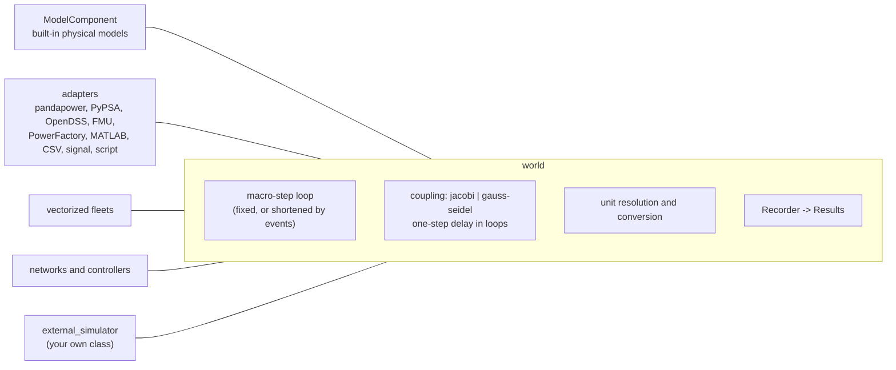

# energysim: Multi-Energy System Co-Simulation

<p align="center">
  
  
</p>

<p align="center">
  <a href="https://pypi.org/project/energysim/"></a>
  <a href="https://www.python.org/downloads/"></a>
  <a href="https://github.com/dgusain1/energysim/blob/main/LICENSE"></a>
</p>

<p align="center">
  <a href="physical-models/" class="md-button md-button--primary">Component library &rarr;</a>
  <a href="#quick-start" class="md-button">Quick start</a>
  <a href="migration-3.0/" class="md-button">Migrating to 3.0</a>
  <a href="https://github.com/dgusain1/energysim" class="md-button">GitHub</a>
</p>

---

`energysim` is a Python package for **co-simulation of multi-energy systems**. A single
`world` object steps a set of simulators in lock-step, exchanges variables between them at every
*macro step*, converts units across connections, and returns a typed `Results` object.

The simulators can be

* **built-in physical models** (batteries, PV, wind, electrolyzers, fuel cells, gas turbines, heat pumps,
  thermal and hydrogen storage, loads) written as `ModelComponent` classes,
* **external tools** behind a common adapter contract: pandapower, PyPSA, OpenDSS, FMUs (FMI 1.0 / 2.0,
  co-simulation and model exchange), DIgSILENT PowerFactory, MATLAB / GNU Octave, CSV profiles, signal
  generators, Python scripts and your own classes,
* **vectorized fleets** of thousands of identical units advanced in one NumPy step,
* **energy networks** (heat, gas) and **controllers** (MPC, OPF, PyPSA rolling horizon).

## What 3.0 is and is not

* Coupling is explicit and non-iterative: `'jacobi'` (default) or `'gauss-seidel'`. Feedback loops are
  detected and solved with a **one-macro-step delay**; reduce `t_macro` or merge the coupled components to
  shrink the delay. Rollback (`save_state` / `restore_state`) and `coupling='iterative'` no longer exist.
* The macro step can be **event driven**: `t_macro` is the maximum step, `t_macro_min` lets scheduled
  events, threshold triggers and adapter hints shorten it. See [Events](events.md).
* Units are first-class: every connected variable is resolved to a unit and converted into the receiver's
  unit. Unspecified units are passed through unscaled with a warning (or raise with
  `unit_policy='strict'`). See [Units](units.md).
* Scenario files are data: `world.from_yaml(..., safe=True)` and `energysim run --safe` refuse anything
  that executes code. See [Safe mode](safe-mode.md).
* Nothing is written to disk unless you ask for it (`out_dir=`, `Results.save()`).

Coming from 2.x? Read [Migrating to 3.0](migration-3.0.md).

## Architecture at a glance



Every simulator is an adapter implementing `step`, `get_value` and `set_value`; the world never branches on
the simulator type. See [Architecture](architecture.md).

## Quick start

A 24 h industrial scenario: a PV plant, a battery, a PEM electrolyzer and a hydrogen tank, driven by
three signal generators. Signals are safe expressions of the time `t` in seconds.

=== "Python API"

    ```python
    from energysim import world
    from energysim.models import PhysicsPV, BatteryBESS, PEMElectrolyzer, H2StorageTank

    w = world(start_time=0, stop_time=24 * 3600, t_macro=900)

    # Weather and set-points: safe expression strings (never eval-ed). Irradiance (W/m2) is not in the
    # unit registry, so it is passed to the PV model unscaled (with a log warning).
    daylight = "max(0, sin(pi * (t - 6 * 3600) / (12 * 3600)))"
    w.add_signal("sun", f"900 * {daylight}", step_size=900)
    w.add_signal("p_el", f"6 * {daylight}", step_size=900, units={"y": "MW"})
    w.add_signal("p_bess", "0.5 * sin(2 * pi * t / 86400)", step_size=900, units={"y": "MW"})

    # Physical models.
    w.add_model("pv", PhysicsPV(p_dc_stc_mw=12.0, inverter_p_ac_max_mw=10.0), step_size=900)
    w.add_model("bess", BatteryBESS(capacity_mwh=4.0, p_max_mw=2.0, soc_init=0.5), step_size=60)
    w.add_model("pem", PEMElectrolyzer(p_nominal_mw=8.0), step_size=60)
    w.add_model("tank", H2StorageTank(volume_m3=100.0, p_init_bar=120.0), step_size=60)

    # Connections: 'sim.variable' -> 'sim.variable'.
    w.add_connections({
        "sun.y": "pv.G_poa",
        "p_bess.y": "bess.P_cmd",
        "p_el.y": "pem.P_cmd",
        "pem.m_dot_H2_kg_hr": "tank.m_dot_in_kg_hr",
    })

    res = w.simulate(pbar=False)          # a Results object; also w.last_results

    print(res["tank.mass_stored_kg"].iloc[[0, -1]])   # pandas Series indexed by time [s]
    print(res.units["tank.mass_stored_kg"])           # 'kg'
    print(res.summary().loc[["pv.P_ac", "pem.m_dot_H2_kg_hr"], ["min", "max", "mean"]])
    ```

=== "Declarative YAML"

    ```python
    from energysim import world

    scenario = """
    world: {start_time: 0, stop_time: 3600, t_macro: 600}
    simulators:
      - {name: load, type: signal, signal: "800 * sin(pi * t / 3600)", step_size: 600,
         units: {y: kW}}
      - {name: wind, type: signal, signal: {type: step, time: 1800, before: 3, after: 9},
         step_size: 600}
    connections: []
    """
    w = world.from_yaml(scenario, safe=True)     # YAML string or file path
    res = w.simulate(pbar=False)
    print(res["load.y"].max())
    ```

    Models, FMUs and networks are added the same way (`type: model`, `type: fmu`, `type: powerflow`, ...);
    see [YAML scenarios and the CLI](yaml-cli.md).

=== "Grid coupling (pandapower)"

    ```python
    import pandapower as pp
    from energysim import world

    net = pp.create_empty_network(name="feeder")
    b1 = pp.create_bus(net, vn_kv=20.0, name="Bus1")
    b2 = pp.create_bus(net, vn_kv=20.0, name="Bus2")
    pp.create_ext_grid(net, b1, name="Grid")
    pp.create_line(net, b1, b2, length_km=2.5, std_type="NAYY 4x150 SE", name="Feeder")
    pp.create_load(net, b2, p_mw=1.2, q_mvar=0.3, name="Load1")

    w = world(start_time=0, stop_time=3600, t_macro=900)
    w.add_powerflow("grid", net=net, inputs=["Load1.p_mw"], outputs=["Bus2.vm_pu"], step_size=900)
    w.add_signal("demand", "800 + 200 * t / 3600", step_size=900, units={"y": "kW"})
    w.add_connections({"demand.y": "grid.Load1.p_mw"})      # 800 kW is converted to 0.8 MW

    res = w.simulate(pbar=False)
    print(res["grid.Bus2.vm_pu"])
    print(w.connection_units()[["from", "to", "from_unit", "to_unit", "scale"]])
    ```

The same scenario at scale (24 h, BESS + PV + CCGT + PEM + tank) is in the
[industrial notebook](notebooks-gallery.md).


*Figure generated by `scripts/generate_doc_figures.py`.*

## Where to go next

| I want to ... | Read |
|---|---|
| see everything the engine does | [Features](features.md) |
| connect pandapower, PyPSA, OpenDSS, FMUs, CSV, scripts | [Simulator adapters](add-simulator.md) |
| write my own simulator class | [External simulators](external-simulators.md) |
| write my own physical model | [Authoring custom models](custom-models.md) |
| run from a YAML file or the command line | [YAML and CLI](yaml-cli.md) |
| schedule outages or react to thresholds | [Events](events.md) |
| run many variants and Monte-Carlo studies | [Ensembles and sweeps](ensemble.md) |
| run untrusted scenario files | [Safe mode](safe-mode.md) |
| understand units and conversions | [Units](units.md) |
| analyse and export results | [Results and KPIs](results.md) |
| optimise dispatch inside a run | [Control and optimisation](control.md) |

## Installation

```bash
pip install energysim        # core: numpy, pandas, tqdm, networkx, pyyaml
```

Everything else is an optional extra:

```bash
pip install energysim[fmu]        # FMPy: FMI 1.0 / 2.0 co-simulation and model exchange
pip install energysim[powerflow]  # pandapower
pip install energysim[pypsa]      # PyPSA (>=0.30,<2)
pip install energysim[opendss]    # OpenDSSDirect.py
pip install energysim[plotting]   # matplotlib
pip install energysim[networks]   # scipy (heat / gas networks)
pip install energysim[control]    # scipy (MPC, OPF, rolling horizon)
pip install energysim[results]    # pyarrow (Parquet results)
pip install energysim[hdf5]       # pytables (HDF5 export; no longer a core dependency)
pip install energysim[all]
```

PowerFactory needs a licensed installation, MATLAB the MATLAB Engine for Python, Octave `oct2py` plus GNU
Octave on `PATH`.

## Community and citation

`energysim` is free software under the GNU General Public License v3.0 by Digvijay Gusain
([@dgusain1](https://github.com/dgusain1)). Issues and discussions:
[GitHub](https://github.com/dgusain1/energysim/issues). Please cite *Gusain, Cvetkovic and Palensky (2019),
Energy flexibility analysis using FMUWorld, IEEE PowerTech*,
[doi:10.1109/PTC.2019.8810433](https://doi.org/10.1109/PTC.2019.8810433).
