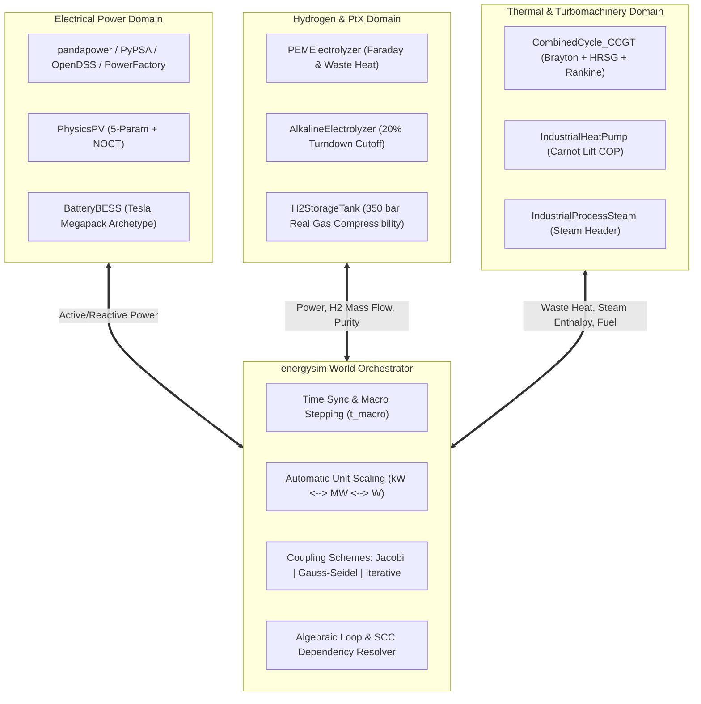
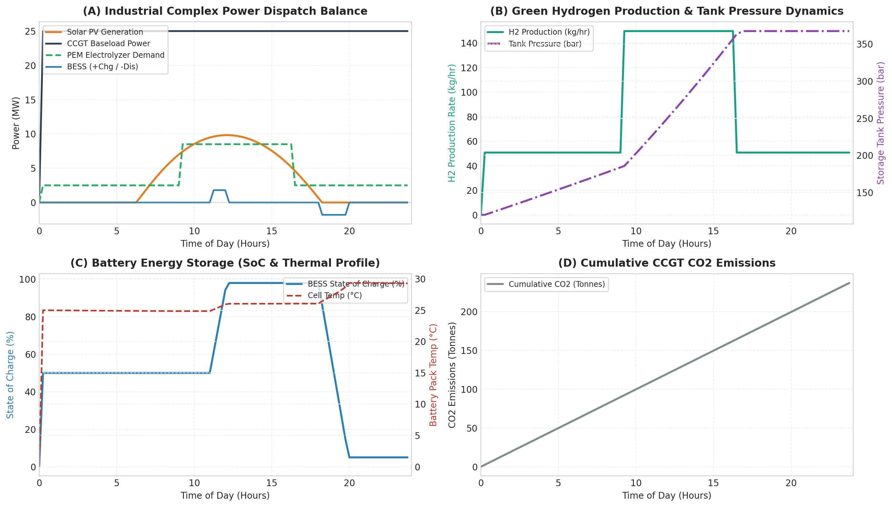

# energysim: Multi-Energy System Modeling & Co-Simulation

<p align="center">
  <picture>
    <source media="(prefers-color-scheme: dark)" srcset="assets/brand/energysim-full-dark.svg">
    <source media="(prefers-color-scheme: light)" srcset="assets/brand/energysim-full-light.svg">
    
  </picture>
</p>


<p align="center">
  <a href="https://pypi.org/project/energysim/"></a>
  <a href="https://www.python.org/downloads/"></a>
  <a href="https://github.com/dgusain1/energysim/blob/main/LICENSE"></a>
  <a href="https://energysim.readthedocs.io"></a>
</p>

<p align="center" style="font-size: 1.25rem; font-weight: 500; color: #555;">
  The high-performance Python framework for multi-energy system (MES) simulation, sector coupling, and heterogeneous co-simulation.
</p>

<p align="center">
  <a href="physical-models/" class="md-button md-button--primary">Explore Component Library &rarr;</a>
  <a href="#quick-start-multi-energy-industrial-complex" class="md-button">Quickstart Example</a>
  <a href="https://github.com/dgusain1/energysim" class="md-button">View on GitHub</a>
</p>

---

## Why energysim?

Modern energy systems are no longer isolated electricity grids. Decarbonizing heavy industry, chemical plants, and municipal networks requires modeling the dynamic interactions between **power grids, green hydrogen electrolyzers, gas turbines, battery storage, and steam networks**.

`energysim` bridges these domains into a unified canvas with guaranteed numerical convergence:

<div class="grid cards" markdown>

-   :material-flash: **Native Multi-Energy Component Library**

    ---

    Built-in, 100% numerically stable models for **Batteries (ECM + thermal + degradation)**, **Solar PV**, **Wind**, **Green Hydrogen (PEM, Alkaline, SOEC)**, **Turbomachinery (CCGT, OCGT)**, **Heat Pumps**, and **Carbon Capture**. Zero brittle DAE crashes.

-   :material-swap-horizontal-bold: **Heterogeneous Co-Simulation Engine**

    ---

    Orchestrate **Pandapower**, **PyPSA**, **OpenDSS**, **DIgSILENT PowerFactory**, **FMUs (FMI 1.0/2.0)**, and **MATLAB/Octave** models with automatic unit scaling (`kW` $\leftrightarrow$ `MW`), dependency ordering, and iterative algebraic loop solving.

-   :material-speedometer: **Ultra-Fast & Vectorized Fleets**

    ---

    Simulate **10,000+ distributed assets** (EVs, residential batteries, PV arrays) in single vectorized NumPy/C memory layouts with microsecond step times. Complete 8,760-hour annual studies in seconds.

-   :material-file-code-outline: **Declarative Scenarios & Dashboards**

    ---

    Define entire multi-carrier topologies in clean, declarative YAML. Validate configurations pre-flight with `energysim validate` and launch automatic interactive Plotly dashboards with `energysim run --dashboard`.

</div>

---

## Architecture at a Glance

`energysim` coordinates heterogeneous models across time steps, routing variables and enforcing physical unit consistency across the energy sectors:



---

## Quick Start: Multi-Energy Industrial Complex

In fewer than 30 lines of readable Python, simulate an industrial refinery microgrid combining a **12 MW Solar PV Plant**, a **Tesla Megapack BESS**, a **40 MW CCGT**, a **10 MW PEM Electrolyzer**, and a **350-bar H2 Storage Tank**:

=== "Python API"

    ```python
    from energysim import world
    from energysim.models import catalog
    from energysim.models.renewables import PhysicsPV
    from energysim.models.hydrogen import PEMElectrolyzer, H2StorageTank
    from energysim.models.thermal import CombinedCycle_CCGT

    # 1. Initialize co-simulation canvas (24-hour run, 15-min macro exchange)
    sim = world(start_time=0, stop_time=86400, t_macro=900)

    # 2. Instantiate physical components
    solar = PhysicsPV(name="pv", p_dc_stc_mw=12.0, inverter_p_ac_max_mw=10.0)
    bess = catalog.Tesla_Megapack_2XL(name="bess", soc_init=0.5)
    electrolyzer = PEMElectrolyzer(name="h2_plant", p_nominal_mw=10.0)
    ccgt = CombinedCycle_CCGT(name="ccgt", p_rated_mw=40.0, min_stable_gen_pct=35.0)
    tank = H2StorageTank(name="tank", volume_m3=100.0, p_max_bar=350.0, p_init_bar=120.0)

    # 3. Add to world
    sim.add_model("pv", model=solar, outputs=["P_ac"])
    sim.add_model("bess", model=bess, outputs=["P_actual", "SoC", "T_batt"])
    sim.add_model("h2_plant", model=electrolyzer, outputs=["P_actual", "m_dot_H2_kg_hr"])
    sim.add_model("ccgt", model=ccgt, outputs=["P_actual", "fuel_consumption_MMBtu_hr"])
    sim.add_model("tank", model=tank, outputs=["pressure_bar", "mass_stored_kg"])

    # 4. Connect variable flows
    sim.add_connections({
        "h2_plant.m_dot_H2_kg_hr": "tank.m_dot_in_kg_hr",
    })

    # 5. Run simulation & view results
    sim.simulate(pbar=True)
    results = sim.results()
    print("Simulation complete! Results extracted to Pandas DataFrames.")
    ```

=== "Declarative YAML"

    ```yaml
    world:
      start_time: 0
      stop_time: 86400
      t_macro: 900
      coupling: jacobi

    simulators:
      - name: pv
        type: model
        model: energysim.models.renewables.PhysicsPV
        parameters:
          p_dc_stc_mw: 12.0
          inverter_p_ac_max_mw: 10.0
        outputs: [P_ac]

      - name: bess
        type: model
        model: energysim.models.catalog.Tesla_Megapack_2XL
        outputs: [P_actual, SoC, T_batt]

      - name: h2_plant
        type: model
        model: energysim.models.hydrogen.PEMElectrolyzer
        parameters:
          p_nominal_mw: 10.0
        outputs: [P_actual, m_dot_H2_kg_hr]

    connections:
      h2_plant.m_dot_H2_kg_hr: tank.m_dot_in_kg_hr
    ```

=== "Grid-Coupled PowerFlow (pandapower)"

    ```python
    import pandapower as pp
    from energysim import world

    # Build distribution feeder in pandapower
    net = pp.create_empty_network(name='microgrid')
    b1 = pp.create_bus(net, vn_kv=20.0, name='Bus1')
    b2 = pp.create_bus(net, vn_kv=20.0, name='Bus2')
    pp.create_ext_grid(net, b1, name='GridSlack')
    pp.create_line(net, b1, b2, length_km=2.5, std_type='NAYY 4x150 SE', name='Feeder')
    pp.create_load(net, b2, p_mw=1.2, q_mvar=0.3, name='Load1')

    # Couple through energysim with automatic unit conversion (kW <-> MW)
    sim = world(start_time=0, stop_time=3600, t_macro=900, power_unit='kW')
    sim.add_powerflow('grid', net=net, inputs=['Load1.p_mw'], outputs=['Bus2.vm_pu'])
    sim.add_signal('controller', lambda t: [800.0 + 200.0 * (t / 3600)], power_unit='kW')
    sim.add_connections({'controller.y': 'grid.Load1.p_mw'})

    sim.simulate()
    ```

### Simulation Results: 24-Hour Multi-Carrier Dynamics

Executing the industrial scenario above solves the multi-physics time progression across power, green hydrogen, battery storage, and carbon emissions in **under 8 seconds**:



* **(A) Multi-Carrier Power Dispatch**: Solar PV peaks at midday ($10\text{ MW}$ AC), CCGT delivers $25\text{ MW}$ firm baseload, and the 10 MW PEM electrolyzer flexes to absorb midday solar generation.
* **(B) Green Hydrogen & 350-bar Storage**: Electrolyzer production ramps up to $170\text{ kg/hr}$, charging the high-pressure buffer tank from $120\text{ bar}$ to $367\text{ bar}$.
* **(C) Battery Energy Storage (SoC & Thermal)**: The Tesla Megapack charges on solar surplus at noon and discharges $1.8\text{ MW}$ into the evening peak, with lumped thermal tracking of cell temperature.
* **(D) Environmental Accounting**: Continuous tracking of cumulative CCGT fuel burn and $\text{CO}_2$ emissions based on part-load heat rates.

---

## Comprehensive Multi-Energy Domain Matrix

`energysim` ships with physical components across 7 sectors and adapters for 10+ external modeling tools:

| Energy Sector | Inbuilt Physical Models | Dynamics Modeled |
|---|---|---|
| **Storage & Batteries** | `BatteryBESS`, `FlowBattery`, `Flywheel` | OCV curves, internal resistance, lumped thermal ODE, calendar & cyclic SOH fade |
| **Renewables** | `PhysicsPV`, `WindTurbine`, `SolarThermal` | POA irradiance, King NOCT cell temperature, Sandia inverter efficiency, air density |
| **Hydrogen & PtX** | `PEMElectrolyzer`, `AlkalineElectrolyzer`, `SOECElectrolyzer`, `H2Compressor`, `H2StorageTank`, `FuelCell_PEM`, `FuelCell_SOFC`, `Methanation` | Ulleberg polarization, Faraday efficiency, 20% turndown safety cutoff, steam enthalpy, real-gas $Z(p, T)$ |
| **Turbomachinery** | `GasTurbine_OCGT`, `CombinedCycle_CCGT`, `ReciprocatingGenset`, `CHP_SteamTurbine` | Part-load heat rate curves, ambient temperature derating, Cold/Warm/Hot startup timers, $\text{CO}_2$ emissions |
| **HVAC & Thermal** | `IndustrialHeatPump`, `ElectricBoiler`, `ElectricChiller`, `AbsorptionChiller`, `ThermalStorageTank` | Temperature-lift Carnot COP, waste heat recovery, stratified sensible thermocline |
| **Carbon & Loads** | `CarbonCapture_Amine`, `DataCenterLoad`, `IndustrialProcessSteam` | Amine reboiler steam consumption, IT load with ambient PUE curve, steam header balance |
| **Equipment Catalog** | `catalog.Tesla_Megapack_2XL`, `catalog.Nel_A1000`, `catalog.GE_7HA_02`, etc. | Calibrated configurations matching real manufacturer datasheets |

---

## Installation

Install core `energysim` (pure Python, lightweight, minimal dependencies):

=== "pip"

    ```bash
    pip install energysim
    ```

=== "uv"

    ```bash
    uv add energysim
    ```

### Optional Simulator Extensions

Install only the simulator bridges your project requires:

```bash
pip install energysim[powerflow]   # pandapower AC/DC power flow & OPF
pip install energysim[fmu]         # FMPy for FMI 1.0 & 2.0 Co-Simulation and Model Exchange
pip install energysim[pypsa]       # PyPSA network dispatch
pip install energysim[opendss]     # OpenDSS distribution networks via OpenDSSDirect.py
pip install energysim[plotting]    # Matplotlib results plotting
pip install energysim[all]         # All optional simulator adapters
```

---

## Community & Citation

`energysim` is free, open-source software licensed under the **GNU General Public License v3.0**.

* **Author**: Digvijay Gusain ([@dgusain1](https://github.com/dgusain1))
* **Documentation**: [energysim.readthedocs.io](https://energysim.readthedocs.io)
* **Issues & Discussions**: [GitHub Issues](https://github.com/dgusain1/energysim/issues)
