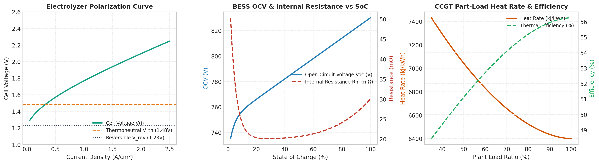

# Physical Component Library

`energysim` includes a native library of **state-dependent empirical physics models** for multi-energy systems (MES), industrial behind-the-meter (BTM) complexes, green hydrogen hubs, and district energy networks.

Instead of relying on fragile, slow acausal DAE solvers that frequently fail to converge during phase changes or valve trips, `energysim` models use **calibrated characteristic curves**, **operating state machines**, and **explicit inertial state integrators**. This guarantees **100% numerical convergence** and sub-second execution even for 8,760-hour annual studies.

---

## Quick Start

All models inherit from `SimulatorAdapter` and can be added directly to the co-simulation world using `add_model()`:

```python
from energysim import world
from energysim.models import catalog
from energysim.models.renewables import PhysicsPV
from energysim.models.hydrogen import PEMElectrolyzer

my_world = world(start_time=0, stop_time=86400, t_macro=900)

# 1. Instantiate physics models
pv = PhysicsPV(name="pv", p_dc_stc_mw=10.0, inverter_p_ac_max_mw=8.5)
bess = catalog.Tesla_Megapack_2XL(name="bess", soc_init=0.5)
h2_plant = PEMElectrolyzer(name="electrolyzer", p_nominal_mw=5.0)

# 2. Add to world
my_world.add_model("pv", model=pv, outputs=["P_ac", "T_cell"])
my_world.add_model("bess", model=bess, outputs=["P_actual", "SoC", "T_batt"])
my_world.add_model("electrolyzer", model=h2_plant, outputs=["P_actual", "m_dot_H2_kg_hr"])

# 3. Connect variables
my_world.add_connections({
    "pv.P_ac": "bess.P_cmd",
    "pv.P_ac": "electrolyzer.P_cmd",
})

# 4. Simulate
my_world.simulate(pbar=True)
results = my_world.results()
```

---

## Calibrated Physics Curves

Every model in `energysim` is underpinned by verified thermodynamic and electrochemical characteristics. Non-linear behaviors—such as temperature-dependent electrolyzer cell polarization, lithium-ion open-circuit voltage variation across state-of-charge, and gas turbine part-load heat rate curves—are calibrated against manufacturer test benches and empirical datasheets:



* **PEM Electrolyzer Polarization Curves**: Temperature-dependent cell voltage $V_{\text{cell}}(j, T)$ capturing reversible potential $E_{\text{rev}}$, activation overpotentials, and ohmic resistance across current density $j \in [0, 2.5]\text{ A/cm}^2$.
* **Li-ion BESS OCV & Resistance**: Nonlinear $V_{\text{oc}}(\text{SoC})$ with steep drops at low SoC ($< 10\%$) and dynamic internal resistance derating $R_{\text{in}}(\text{SoC})$ as functions of cell state.
* **CCGT Part-Load Heat Rate**: Combined-cycle Brayton + Rankine heat rate derating ($q_{\text{heat}}$ in $\text{MMBtu/MWh}$) capturing steep thermodynamic efficiency drop below $50\%$ load.

---

## 1. Storage & Electrochemical Domain

### `BatteryBESS`
Lithium-ion Battery Energy Storage System (LFP / NMC chemistry).

#### Governing Equations & Physics

* **Open-Circuit Voltage**:
  $$V_{\text{oc}} = f(\text{SoC}, T)$$
  Evaluated via calibrated piecewise polynomial / lookup curve.
* **DC Terminal Voltage & Current**:
  $$V_t = V_{\text{oc}} + I \cdot R_{\text{in}}(\text{SoC})$$
  $$P_{\text{dc}} = V_t \cdot I$$
* **AC/DC Inverter Efficiency**:
  $$P_{\text{grid}} = \begin{cases} P_{\text{dc}} / \eta_{\text{inv}}(P), & \text{discharging} \\ P_{\text{dc}} \cdot \eta_{\text{inv}}(P), & \text{charging} \end{cases}$$
* **Thermal ODE (1-State Lumped)**:
  $$C_{\text{th}} \frac{dT_{\text{batt}}}{dt} = I^2 R_{\text{in}} - \frac{T_{\text{batt}} - T_{\text{amb}}}{R_{\text{th}}}$$
* **State of Health (SOH) Degradation**:
  Combines Arrhenius calendar aging and cyclic throughput fade:
  $$\Delta \text{SOH} = k_{\text{cal}} \cdot e^{-\frac{E_a}{R T}} \cdot \Delta t + \frac{|P_{\text{dc}}| \Delta t}{2 \cdot E_{\text{cap}} \cdot N_{\text{cycle}}}$$

#### Parameters & Interfaces
* **Inputs**: `P_cmd` (MW, positive = charge, negative = discharge), `T_amb` (°C)
* **Outputs**: `P_actual` (MW), `SoC` (0–1), `T_batt` (°C), `SOH` (0–1), `V_terminal` (V), `I_current` (A), `Q_heat_kW` (kW)

---

### `FlowBattery`
Vanadium Redox Flow Battery (VRFB) featuring decoupled power stack (MW) and electrolyte tank capacity (MWh) with state-dependent variable-speed pump parasitic losses:

$$P_{\text{parasitic}} = P_{\text{base}} + P_{\text{var}} \cdot \left(\frac{|P|}{P_{\text{nom}}}\right)^2$$

---

### `Flywheel`
High-speed mechanical kinetic storage for primary frequency regulation with standby aerodynamic drag and bearing losses:

$$\frac{d\text{SoC}}{dt} = \frac{P \cdot \sqrt{\eta_{\text{rt}}}}{E_{\text{cap}}} - k_{\text{self\_discharge}} \cdot \text{SoC}$$

---

## 2. Renewable Generation Domain

### `PhysicsPV`
Utility-scale or distributed solar photovoltaic system.

#### Governing Equations & Physics
* **Cell Temperature ($T_{\text{cell}}$)**:
  Uses the King / NOCT thermal model with wind damping:
  $$T_{\text{cell}} = T_{\text{amb}} + \left(\frac{\text{NOCT} - 20}{800}\right) \cdot G_{\text{POA}} \cdot \frac{1}{1 + 0.05 \cdot \max(0, v_{\text{wind}} - 1)}$$
* **DC Power Output with Thermal Derating**:
  $$P_{\text{dc}} = P_{\text{dc,STC}} \cdot \left(\frac{G_{\text{POA}}}{1000}\right) \cdot \left[1 + \gamma \cdot (T_{\text{cell}} - 25)\right]$$
  where $\gamma \approx -0.38\%/\text{K}$ for silicon PV.
* **Inverter Clipping & Curtailment**:
  $$P_{\text{ac}} = \min\left(P_{\text{dc}} \cdot \eta_{\text{inv}}, P_{\text{ac,max}}, P_{\text{curtail}}\right)$$

---

### `WindTurbine`
Wind turbine generator with multi-point $P(v)$ power curve, air density derating, and 1st-order rotor inertia acceleration lag:

$$\tau_{\text{rotor}} \frac{dP_{\text{actual}}}{dt} = P_{\text{target}}(v, \rho) - P_{\text{actual}}$$

---

## 3. Hydrogen & Power-to-X (PtX) Domain

### `PEMElectrolyzer`
Proton Exchange Membrane Electrolyzer with empirical Ulleberg polarization and Faraday efficiency.

#### Governing Equations & Physics
* **Polarization Curve**:
  $$V_{\text{cell}} = V_{\text{rev}} + r \cdot j + s \cdot \ln(t \cdot j + 1)$$
* **Faraday Efficiency**:
  Captures low-current parasitic gas crossover:
  $$\eta_F(j) = \frac{j^2}{f_1 + j^2} \cdot f_2$$
* **Hydrogen Production Rate**:
  $$\dot{m}_{\text{H2}} = \eta_F \cdot \frac{N_{\text{cells}} \cdot I}{2 \cdot F} \cdot M_{\text{H2}} \quad [\text{kg/s}]$$
* **Demineralized Water Consumption**:
  $$\dot{m}_{\text{H2O}} = \dot{m}_{\text{H2}} \cdot \frac{M_{\text{H2O}}}{M_{\text{H2}}} \approx 8.936 \cdot \dot{m}_{\text{H2}} \quad [\text{kg/s}]$$
* **Recoverable Waste Heat**:
  $$\dot{Q}_{\text{waste}} = P_{\text{elec}} - \dot{m}_{\text{H2}} \cdot \text{LHV}_{\text{H2}}$$

---

### `AlkalineElectrolyzer`
Atmospheric or pressurized liquid KOH alkaline electrolyzer with **strict minimum turndown limit ($20–30\%$)**:
* If $P_{\text{cmd}} < P_{\text{min\_turndown}}$, the stack automatically trips to `STANDBY` to prevent dangerous hydrogen/oxygen gas crossover.

---

### `SOECElectrolyzer`
Solid Oxide Electrolyzer operating at $650–850^\circ\text{C}$ utilizing high-temperature industrial steam:
* Leverages thermoneutral voltage $V_{\text{tn}} \approx 1.287\text{ V}$ to split energy demand between electricity ($\approx 38\text{ kWh/kg}$) and thermal steam ($\approx 9\text{ kg steam/kg H}_2$).

---

### `H2Compressor` & `H2StorageTank`
* **Compressor**: Multi-stage isentropic compression from 30 bar to 350 / 700 bar with intercooling heat rejection.
* **Storage Tank**: Dynamic mass accumulator with real-gas compressibility:
  $$p \cdot (V - \alpha \cdot n \cdot R \cdot T) = n \cdot R \cdot T$$

---

## 4. Turbomachinery, Engines & Cogeneration

### `GasTurbine_OCGT`
Open-Cycle Peaking Gas Turbine.
* **Ambient Temperature Derating**: $P_{\text{max}}(T_{\text{amb}})$ curve accounting for air mass density reduction on hot days.
* **Part-Load Heat Rate**: $\text{HR}(L)$ curve ($L = P / P_{\text{rated}}$) modeling efficiency drop-off.
* **Startup State Machine**: Cold ($>48\text{h}$ offline), Warm ($8–48\text{h}$ offline), Hot ($<8\text{h}$ offline) timers with fuel burn penalties.

---

### `CombinedCycle_CCGT`
Combined Cycle Gas Turbine (Topping GT + Dual-Pressure HRSG + Bottoming Steam Turbine).
* GT/ST capacity split (typically 2:1).
* Minimum Stable Generation (MSG, typically 35–45%).
* Continuous $\text{CO}_2$ emissions rate based on fuel carbon intensity ($\approx 0.0592\text{ tCO}_2/\text{MMBtu}$).

---

## 5. Heating, Cooling & Carbon Capture

* **`IndustrialHeatPump`**: Carnot lift-dependent $\text{COP} = \eta_{\text{carnot}} \cdot \frac{T_{\text{sink}}}{T_{\text{sink}} - T_{\text{source}}}$.
* **`ElectricBoiler`**: Fast-response steam boiler ($99\%$ electrical efficiency).
* **`AbsorptionChiller`**: Converts industrial waste heat or low-pressure steam into chilled water.
* **`CarbonCapture_Amine`**: Post-combustion amine scrubbing modeling reboiler steam consumption ($2.5–3.5\text{ GJ/tCO}_2$) and blower parasitics.

---

## 6. Commercial Equipment Catalog (`catalog`)
Ready-to-use equipment archetypes calibrated against published OEM datasheets:

```python
from energysim.models import catalog

bess = catalog.Tesla_Megapack_2XL(name="bess")     # 1.93 MW / 3.92 MWh LFP
ael  = catalog.Nel_A1000(name="ael")               # 2.2 MW Alkaline
pem  = catalog.ITM_Power_Trident(name="pem")       # 5.0 MW PEM
soec = catalog.Bloom_Energy_SOEC(name="soec")      # 1.0 MW High-temp steam
ccgt = catalog.GE_7HA_02(name="ccgt")              # 573 MW Combined Cycle
gt   = catalog.Siemens_SGT_800(name="gt")          # 62 MW Gas Turbine
pv   = catalog.CanadianSolar_HiKu7(name="pv", p_mw=10.0) # 10 MW Utility PV
wind = catalog.Vestas_V150_4MW(name="wind")        # 4.2 MW Wind Turbine
```
