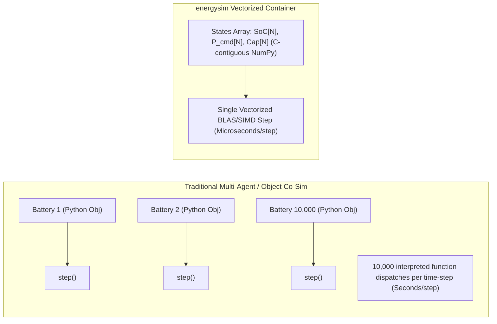

# Vectorized Fleet Containers

Large-scale co-simulations involving tens of thousands of Distributed Energy Resources (DERs) — such as rooftop solar PV, residential batteries, electric vehicles, and smart thermostats — typically suffer severe performance bottlenecks when implemented as individual interpreted Python objects. 

`energysim` solves this via **Vectorized Container Simulators** (`VectorizedContainerAdapter`).

---

## Core Architecture

Instead of instantiating 10,000 separate model objects and dispatching 10,000 Python method calls every micro time-step, a **Vectorized Container** stores the states and parameters of all $N$ assets in **contiguous 1-D C-memory NumPy arrays**:



### Key Architectural Capabilities

1. **Scalar Broadcast & Vector Control**:
   - Setting a scalar input (e.g. `ambient_temperature = 22.0`) automatically broadcasts to all $N$ entities.
   - Passing an $N$-element array updates each entity individually.
   - Setting an indexed variable (e.g. `p_cmd[42] = 5.0`) modifies only the specified unit.
2. **Instant Aggregation Outputs**:
   - Any state vector automatically exposes aggregated metrics: `total_<var>`, `mean_<var>`, `min_<var>`, and `max_<var>`.
3. **Sub-millisecond Step Speeds**:
   - Stepping 10,000 batteries or PV arrays takes fewer than **300 microseconds**, enabling annual (8,760 hours) co-simulations to complete in seconds.

---

## Ingesting Defined Physical Models and Archetypes

You can instantiate large vectorized fleets directly from calibrated physical component models (e.g., [`BatteryBESS`](../components/bess.md), [`PhysicsPV`](../components/pv.md), [`IndustrialHeatPump`](../components/heat_pump.md)) or equipment archetypes (e.g., `models.archetypes.BESS_2h_2MW`):

```python
import energysim as es
from energysim import models

# 1. Define parameterized physical components / archetypes
ev_pack = models.BatteryBESS(capacity_mwh=0.060, p_max_mw=0.011, soc_init=0.6)
solar = models.PhysicsPV(p_dc_stc_mw=0.005)
heat_pump = models.IndustrialHeatPump(q_max_thermal_mw=0.010, carnot_efficiency=0.50)

# 2. Ingest directly into 1,000-unit vectorized fleets!
sim = es.World(start_time=0, stop_time=3600, t_macro=900)

# Pass model=... and optional spread for stochastic entity-to-entity heterogeneity
sim.add_fleet("evs", model=ev_pack, size=1000, spread=0.10, seed=42)
sim.add_fleet("solar", model=solar, size=1000, spread=0.15, seed=43)
sim.add_fleet("hp", model=heat_pump, size=1000, spread=0.10, seed=44)
sim.add_fleet("houses", kind="building", size=1000, initial_t_indoor=20.0, spread=0.10)
```

The `spread` parameter (e.g. `spread=0.10` for $\pm 10\%$) applies Gaussian variation across the $N$ entities' rated capacities and uniform variation across their initial states, ensuring realistic fleet diversity without manual loops.

---

## Container Catalog

* [**Storage Fleet**](storage_fleet.md): Heterogeneous residential battery storage and EV charging aggregation.
* [**Solar PV Fleet**](pv_fleet.md): Distributed rooftop solar arrays with spatial irradiance and temperature derate.
* [**Building Thermal Fleet**](building_fleet.md): 1R1C lumped thermal envelope fleets for demand response.
* [**Heat Pump Fleet**](heat_pump_fleet.md): Temperature-lift dependent Carnot COP heat pump aggregation.
* [**Build Your Own Vectorized Fleet**](custom_fleet.md): Step-by-step tutorial on subclassing `VectorizedContainerAdapter`, `SimpleVectorizedModel`, or using `VectorizedFunctionAdapter`.
